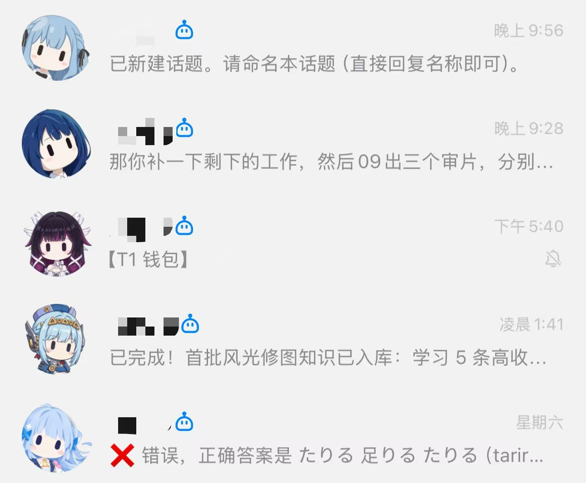

QQ Bot Bridge 1.1.0
====================

把 QQ 官方机器人连接到本机 Codex CLI，并提供本地聊天面板。

功能
----
- 支持一个或多个 QQ 官方机器人。
- 强制 openid 白名单；白名单为空时进入安全模式。
- 本地聊天面板：http://127.0.0.1:17890
- 话题隔离、话题切换、话题归档。
- 收件箱模式、批量直连、停止当前任务。
- QQ 文件收件箱、面板通知接口。
- 独立 Windows 托盘程序。

重点功能
--------

收件箱模式：把碎片化想法先登记、后处理
- 在当前话题发送“收件箱模式”后，后续文本只会被登记，不会立刻调用大模型。
- 想法可以一条条随手发送，不需要当场组织成完整需求。
- 发送“直连”时，桥接会把本批内容按顺序打包成一次任务交给大模型。
- 多条短想法合并成一轮处理，可以减少对话轮次、上下文拼接和等待时间。
- 不紧急的任务可以先登记，留到模型服务更空闲或费用更低的时段再集中执行，避开繁忙高峰。
- 发送“清空并直连”可以丢弃当前批次并直接恢复普通对话。

桌面聊天面板：离开手机后继续原来的对话
- 桌面浏览器可直接打开本地聊天面板，查看手机端留下的消息和回复。
- 面板与 QQ 手机端共享机器人、话题和聊天记录，可以接着已有话题继续对话。
- 在桌面面板发送消息时，可同步推送到 QQ，方便离开电脑后继续在手机上查看结果。
- 支持话题新建、切换、重命名和归档，同一机器人下的不同工作可以保持上下文隔离。
- 托盘程序负责启动和常驻桥接，桌面面板关闭后不影响后台任务。
- 上方示例图展示手机 QQ 中同时使用多个机器人和话题的实际效果。

环境
----
- Windows 10/11
- Node.js 22 或更高版本
- Codex CLI 已安装并已登录

快速开始
--------
1. 在 QQ 开放平台创建机器人，取得 AppID 和 AppSecret。
2. 将 .env.example 复制为 .env。
3. 在 .env 中填写 QQBOTS_JSON。
4. 运行 start.bat，或执行 node bridge.mjs。
5. 给机器人发送一条消息。
6. 从 logs/bridge.log 取得 openid。
7. 将 openid 填入 ALLOWED_OPENIDS。
8. 重启桥接。

托盘启动
--------
运行 qq-bot-tray.ps1。首次运行时会尝试编译 QQBotTray.exe。
运行 start-panel.ps1 可在桥接未启动时拉起桥接并打开聊天面板。

通用面板示例
------------
- examples/menu.json：新话题、切换话题、归档话题、收件箱模式、直连、清空并直连。
- examples/panel.json：常用快捷指令面板。

使用 tools/qq-menu.mjs 下发示例前，请先确认目标机器人。

安全
----
- 不要把 .env 提交到版本库或发送给他人。
- 不要在公开仓库中保存真实 AppID、AppSecret、openid、日志或聊天记录。
- 生产环境建议保持白名单最小化。

API
---
POST /api/notify
{"bot":"main","message":"通知文本"}

POST /api/send
{"bot":"main","message":"交给 Codex 的内容","pushQQ":true}

本地接口只绑定 127.0.0.1，并校验本机来源。

许可证
------
MIT
